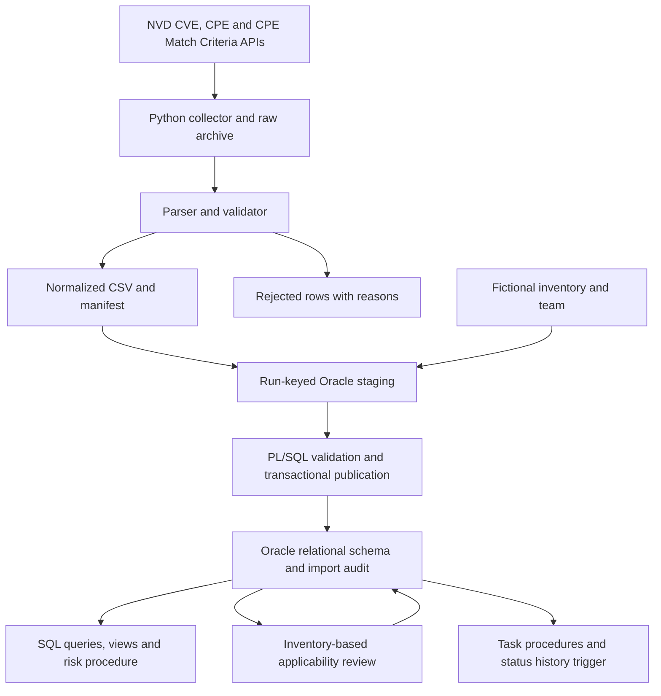

# Architecture

## Source and import contracts

Archive original pages and record their checksums, query filters and capture times. Follow response pagination metadata. Handle transient failures with bounded retries, rate pacing and backoff. Keep API keys in environment variables. Preserve whole applicability trees as original text, with relational rows for reporting criteria. Consult the CPE Dictionary or Match Criteria API for scoped reconciliation and preserve the original criterion when no dictionary result is available. [NVD CVE API](https://nvd.nist.gov/developers/vulnerabilities) · [NVD product APIs](https://nvd.nist.gov/developers/products)

Stage and validate whole CVE records with their children. Use one publisher per source, bind parameters, preserve stable CVE and product IDs, and update a CVE and its current child sets in one transaction. Reject conflicting same-timestamp revisions for review and ignore older revisions. Preserve previous revisions referenced by finding evidence through their immutable import archives. Track retrieved, accepted, rejected and applied amounts separately, with the accepted total including unchanged or stale records. Keep failure audit updates durable after database rollback.

## Applicability

Use CPE 2.3 component parsing, including escaped separators and distinct wildcard and not-applicable values. Keep `vulnerable=false` environment predicates, Boolean operators and negation in the source expression. Product and version narrowing can support review. A verified finding requires evidence for the complete applicable branch, including relevant environment conditions. Use supported product-specific version rules or documented analyst review. Unrecognized versions, missing inventory and unimplemented Boolean cases stay pending. Review is against supplied fictional inventory and source metadata.

## Oracle 11g target

Use sequences with insert triggers, constraints, explicit indexes, `MERGE`, analytic functions, and CLOB for long descriptions and source expressions. Keep object names within 30 bytes and specify string length semantics explicitly. Use UTC and preserve source timestamp precision with `TIMESTAMP(3)` where revisions are compared. Keep caller-owned DML transactions and compile with a fail-fast setup script that also checks invalid objects. Use a compatible SQL*Plus client or verify a pinned Python driver in Thick mode with compatible Oracle Client libraries against the actual server release. [Oracle 11g SQL reference](https://docs.oracle.com/cd/E11882_01/server.112/e41084.pdf) · [Driver interoperability](https://python-oracledb.readthedocs.io/en/v3.3.0/user_guide/installation.html)
